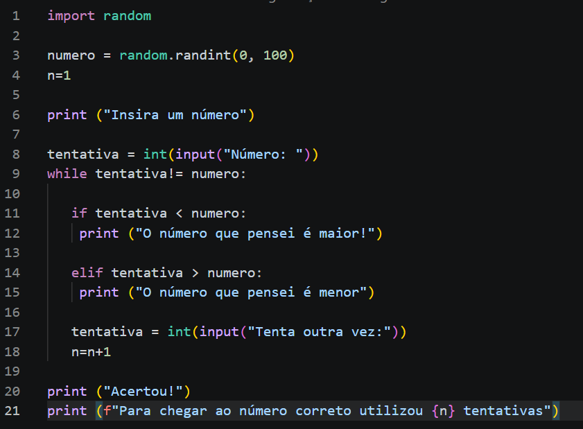

# TPC2 - Jogo "Adivinha o número"
 
## Autor
 
- Nome: Letícia Freitas Lopes
- Número: A114777
- Foto:

## Resumo
O objetivo era criar um programa em Python para jogar o jogo "Adivinha o número". Eu utilizei a modalidade do computadore escolher um número aleatório e o utilizador tentar adivinhar. Quando acertar, é imprimido o número de tentativas.
## Resultados

